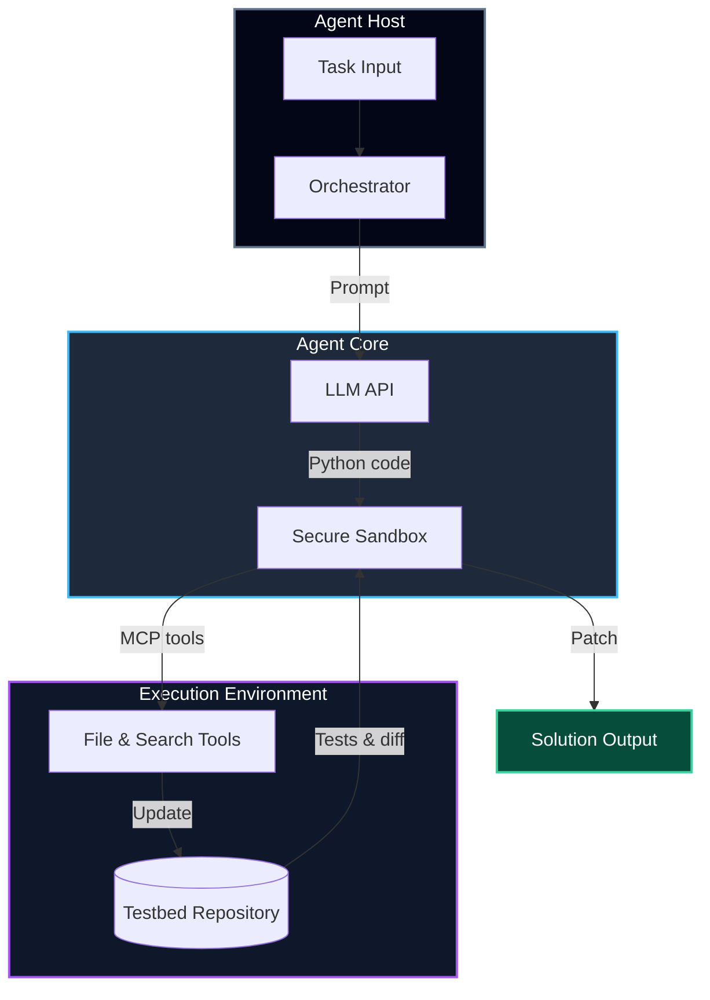

*This project has been created as part of the 42 curriculum by aberrami.*

## Description

**Agent Smith** is an autonomous AI software engineering agent capable of reasoning, writing, executing, and refining code to solve algorithmic and real-world debugging challenges. 

Unlike traditional LLM approaches that output a static final answer, Agent Smith operates through a continuous, closed-loop **Thought → Code → Observation** paradigm. It leverages a secure, highly configurable Python sandbox to execute generated code and uses the **Model Context Protocol (MCP)** to interact dynamically with external tools (such as file systems, code search, and test execution environments). 

The project targets two primary benchmarks:
1. **MBPP (Mostly Basic Python Problems):** Solving algorithmic coding tasks.
2. **SWE-bench:** Resolving real-world bug fixes and issues in production repositories via Dockerized environments.

---

## Instructions

### Prerequisites
- **Python 3.10**
- **uv** (Package manager)
- An API key from a supported provider (e.g., OpenRouter, Gemini, Groq) exported as an environment variable.

### Installation
Clone the repository and sync dependencies using `uv`:
```bash
git clone <repository-url>
cd agent_smith
uv sync
```
### Configuration
Create a ```.env``` file at the root of your repository and add your API keys:
```ENV
OPENROUTER_API_KEY=your_api_key_here
```
### Execution
1. Running the MBPP Agent
To execute an MBPP task:
```Bash
cd student
uv run python -m agent_mbpp --task-file ../cache/mbpp_task.json --output ../cache/mbpp_solution.json --model-name "model/name" --provider-url "https://provider.api/v1"
```

2. Running the SWE-bench Agent
To execute a SWE-bench task inside the Docker environment:
```Bash
uv run python -m student.agent_swebench   --task-file /cache/swebench_task.json   --output test_solution.json   --model-name "qwen/qwen3.8-27b"   --provider-url "https://api.groq.com/openai/v1/chat/completions"
```
## System Architecture
Agent Smith is built using a clean, modular architecture separating the agent's reasoning loop from the execution environment and tool interfaces:
- Orchestrator (orchestrator.py): Manages the central while loop, handles multi-turn LLM requests, extracts code blocks, and tracks cumulative token usage and execution metrics.
- LLM Client (llm_client.py): Provides provider-agnostic API calling with automatic multi-token rotation to handle rate limits and quotas.
- Sandbox (sandbox.py): Acts as the primary security boundary between the LLM and the real world.
- MCP Server (mcp_server.py & tools.py): Exposes mandatory file system, search, and execution tools via the Model Context Protocol.




## Agent Loop Explanation
The agent operates through an iterative Thought → Code → Observation cycle:
1. Thought: The LLM receives the system prompt, tool manual, and problem description, and outputs its reasoning along with a Python code block.
2. Code Extraction & Sandbox Execution: The orchestrator extracts the Python code and sends it to the Sandbox. The sandbox executes the code in a restricted namespace.
3. Observation: The execution result (stdout, stderr, or tool output) is captured and fed back into the LLM's message history as an Observation.
4. Termination: The loop continues until the model calls the built-in final_answer(solution) function, or until hard limits (maximum iterations, token caps, or timeouts) are reached.

## Sandbox Design
Running untrusted LLM-generated code presents severe security risks. Agent Smith implements a rigorous sandbox using only standard Python libraries and builtins (no external packages like RestrictedPython):
- Import Restrictions: Uses a strict allowlist. Any unlisted module import (e.g., os, subprocess) raises an ImportError.
- Process Isolation: Code execution runs in a separate subprocess, enabling reliable termination for infinite loops or runaway code via execution timeouts (max_execution_time_seconds).
- Filesystem Boundaries: File access is restricted to authorized directories (e.g., /testbed, /tmp/agent).
- Dynamic Tool Discovery: The sandbox dynamically queries the connected MCP server at runtime to discover tools, generating an automated tool manual that is injected into the LLM system prompt.
- Exception Propagation: Control-flow exceptions like KeyboardInterrupt and SystemExit are correctly propagated for safe shutdown.

## Tool Implementation Details
All mandatory tools are exposed via an MCP server and callable as native Python functions from within the sandbox:

- File System Tools:
    - read_file(filepath, start_line, end_line): Reads file content with explicit line numbers (similar to cat -n).
    - edit_file(filepath, old_str, new_str): Performs precise string replacements.
    - list_files(directory, pattern): Recursively lists files matching a given regex pattern.
- Code Search Tools:
    - search_code(pattern, file_pattern): Grep-like search across the repository.
- Execution Tools:
    - run_command(command, workdir): Executes shell commands in the repository sandbox.
    - get_patch(): Retrieves the unified git diff (git -c core.fileMode=false diff) of all changes made to the repository.
    - run_tests(): Executes the task's official evaluation script.